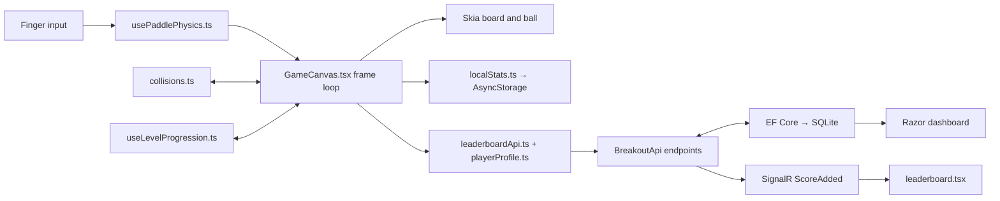
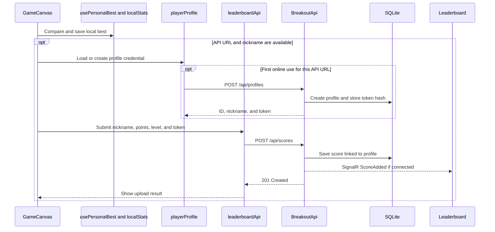

# Breakout architecture and walkthrough

## The short explanation

The Expo app simulates and renders the entire game. BreakoutApi receives completed run results, stores them in SQLite, and serves rankings and profile history. A slow or unavailable API affects those online features. A run can still end and update the on-device best.

For a first read, follow [the menu](../src/app/index.tsx) to [the game route](../src/app/game.tsx), [the board](../src/components/game/GameCanvas.tsx), [the collision functions](../src/game/collisions.ts), and finally [the HTTP client](../src/services/leaderboardApi.ts). Then open `Program.cs` in BreakoutApi and trace the score handler to `AppDbContext`.

## Expo app file map

| File or folder | What it owns and what it talks to |
| --- | --- |
| [src/app/_layout.tsx](../src/app/_layout.tsx) | Mounts the Expo Router stack under the gesture root, safe-area provider, and app providers. The root, navigator, native window, and screen content use the current theme background. Screens use a fade transition. |
| [src/app/index.tsx](../src/app/index.tsx) | Main menu. Validates and saves the nickname through `PlayerNameContext`, then routes to the game, settings, profile, or leaderboard. |
| [src/app/game.tsx](../src/app/game.tsx) | Reads [useOnboarding.ts](../src/hooks/useOnboarding.ts). Shows [HowToPlayOverlay.tsx](../src/components/onboarding/HowToPlayOverlay.tsx) until acknowledged, then mounts the active game canvas. |
| [src/app/settings.tsx](../src/app/settings.tsx) | Theme and haptics controls. Updates the two settings providers and uses [accordion-section.tsx](../src/components/ui/accordion-section.tsx) for collapsible sections. |
| [src/app/personal-best.tsx](../src/app/personal-best.tsx) | The **My Profile** screen at the existing `/personal-best` route. On focus, reads the on-device record from `localStats.ts` and requests online stats through `playerProfile.ts` when a nickname and API URL are available. Shows [FriendsPanel.tsx](../src/components/profile/FriendsPanel.tsx) as soon as the screen opens. The full-screen Find people view keeps the search field above the scrollable results. |
| [src/app/leaderboard.tsx](../src/app/leaderboard.tsx) | Loads ranked runs in pages of 50 using `leaderboardApi.ts`. While focused, listens to SignalR for new-score notices. Applies them when the player taps the refresh banner or refreshes the list. |
| [src/components/game/GameCanvas.tsx](../src/components/game/GameCanvas.tsx) | Calculates board size and provides the frame loop, serve direction line, Skia game objects, header, power-up row, pause and level overlays, and game-over handling. |
| [src/components/game/PowerUpBadge.tsx](../src/components/game/PowerUpBadge.tsx) | Takes a shared countdown fraction, label, and color. Hides when the fraction reaches zero. The parent canvas screen places the badges in a fixed row under the play/pause button, outside the drawing surface. |
| [src/components/menu/LiveMenuBackground.tsx](../src/components/menu/LiveMenuBackground.tsx) and [useLiveBackground.ts](../src/hooks/useLiveBackground.ts) | Draw and animate decorative shapes on the main menu. This animation has its own state and frame callback. |
| [src/game/config.ts](../src/game/config.ts), [entities.ts](../src/game/entities.ts), and [brickLayout.ts](../src/game/brickLayout.ts) | Theme palettes, responsive board size, entity types and defaults, and the row/column layout used by generation and collision lookup. |
| [src/game/levelGenerator.ts](../src/game/levelGenerator.ts), [collisions.ts](../src/game/collisions.ts), and [colorUtils.ts](../src/game/colorUtils.ts) | Generate levels, simulate contacts, and shade multi-hit bricks based on remaining HP. They can be called outside a React render. |
| [src/game/haptics.ts](../src/game/haptics.ts) | Wraps Expo Haptics for paddle hits, damaged or destroyed bricks, level-ups, power-ups, and game over. The user's haptics setting is checked before feedback. |
| [src/context](../src/context) | Holds the current theme, haptics setting, and player nickname across screens. Each provider loads and saves its own AsyncStorage key. |
| [src/services](../src/services) | Keeps local persistence, profile credentials, and HTTP requests out of the frame loop. |

[app.json](../app.json) defines app metadata, icons, portrait orientation, Expo plugins, and typed routes. [eas.json](../eas.json) defines development, preview, and production build profiles. [babel.config.js](../babel.config.js) includes the Reanimated worklet transform. [tsconfig.json](../tsconfig.json) defines strict TypeScript, source aliases, and exclusions for the unused `GameCanvas1.tsx` and `GameCanvas2.tsx` prototypes. The template theme helper files and the original JavaScript prototypes are outside the active game path.

## From touch to launch

1. `GameCanvas.tsx` measures the board's left and top offset inside the gesture area. The ball waits on the paddle at its center, one radius above its top.
2. [usePaddlePhysics.ts](../src/hooks/usePaddlePhysics.ts) receives the finger's current coordinates in the gesture area. It subtracts the board offset and the ball's origin, then calculates the angle and distance to the finger. This keeps the guide at the same angle when the finger reaches the same point from different starting positions.
3. [useAiming.ts](../src/hooks/useAiming.ts) owns the shared aiming flag, angle, and distance. The guide and launch use the same angle, measured from vertical and limited to ±70°. A successfully completed gesture launches the ball. A cancelled gesture keeps it on the paddle.
4. After launch, the gesture uses the horizontal change in finger position to move the paddle, constrained by the board width. The frame loop also measures the paddle's own velocity for a small bounce nudge.

## One physics frame

`GameCanvas.tsx` runs `useFrameCallback`. Each frame returns early while paused, during a level announcement, or after game over. While aiming, it snaps the ball to the paddle and waits. During play it converts elapsed time to 60 Hz frame units and divides movement into shorter steps, bounded by the ball radius and half the brick dimensions. Smaller movement steps reduce tunneling through bricks.

For each step, the ball moves, then `handleAllCollisions` checks the walls, nearby bricks, and the paddle in that order. The result updates shared ball coordinates and velocities. Skia reads the coordinates directly. The loop separately updates falling power-ups and checks whether the ball reached the bottom of the board.

### Walls, bricks, and paddle

| Contact | How it works |
| --- | --- |
| Wall | Clamp the ball back inside the left, right, or top boundary and point the corresponding velocity component inward. The bottom is the game-over boundary. |
| Brick | Look through nearby cells in the row-major grid. Find the closest point on each candidate rectangle to the ball center. The squared distance must be within the ball's squared radius, and the velocity must point into the contact. If several bricks qualify, resolve the deepest contact for that step. Reflect across the contact normal and push the ball out of the overlap. This changes both velocity components on a diagonal corner hit. |
| Paddle | For a descending ball, test its circle against the paddle's top edge. Map the horizontal contact position to an outgoing angle. A stationary center hit goes straight up and an edge hit reaches ±50°. Paddle movement can add up to 12° of nudge and the combined angle is capped at ±60°. Speed rises by 1% per paddle bounce up to twice the serve speed. |
| Bottom | When the ball's bottom reaches the board's bottom, stop the run and schedule game-over handling once. |

To explain a corner near miss, imagine the ball's center six pixels left and six pixels above a brick corner. Its distance is about 8.5 pixels, so a radius-eight ball misses. A bounding-square overlap would have registered that as a hit.

### What lives on each thread

- **UI worklets and shared values** hold moving positions, velocity, aim, the physics copy of brick HP, combo state, power-up state, and the final run score. A worklet is a function marked `"worklet"` so Reanimated can run it on the UI runtime.
- **React and JS** hold the displayed bricks, displayed score and level, overlays, local storage, and network requests. [useLevelProgression.ts](../src/hooks/useLevelProgression.ts) gives physics its own board copy so it can resolve consecutive hits while React catches up.
- **The bridge** is `runOnJS`. A hit reports the brick ID, exact remaining HP, and destruction state. React updates the rendered brick by ID. When a brick breaks, the frame loop also updates its own run score so score upload can use the final value even if a React render is still pending.

## Levels, scoring, pause, and power-ups

- **Levels.** `levelGenerator.ts` builds six columns and four to seven rows. Empty slots remain `null` so the grid indices still match the positions. Each level has random gaps and an HP limit that rises to four. After every brick is cleared, `useLevelProgression.ts` announces and starts the next level, resets the play systems and preserves the accumulated score. **Play Again** starts level 1 with zero points.
- **Points and combos.** A destroyed brick earns `(rowCount - rowIndex) × 10` base points. [useComboSystem.ts](../src/hooks/useComboSystem.ts) adds 0.5× every three consecutive destroyed bricks, up to 3×. A paddle hit or level reset clears the streak. The game rounds the multiplied points on each destroyed brick.
- **Power-ups.** [usePowerUps.ts](../src/hooks/usePowerUps.ts) rolls a 15% chance on a brick break while eligible. Only one pickup can fall or take effect at a time. A two-second cooldown follows a missed pickup or the end of an effect. Catching turquoise **Wider paddle** makes the paddle 1.5 times wider for eight seconds. Catching orange **Slow ball** makes movement 0.55 times as fast for six seconds. The countdown shares the effect's remaining fraction with the corresponding badge. The loop stops updating while paused, but an active effect can expire when play resumes because the timers use frame timestamps.
- **Pause.** The header button can pause the game. [usePauseOnBackground.ts](../src/hooks/usePauseOnBackground.ts) also pauses when the app leaves the foreground. The player resumes explicitly.

## From game over to online history

[usePersonalBest.ts](../src/hooks/usePersonalBest.ts) calls [localStats.ts](../src/services/localStats.ts). The device stores one best per installation or browser, using score as the comparison. The read and write stay independent of whether the run reaches the API.

[playerProfile.ts](../src/services/playerProfile.ts) looks for a credential scoped to the configured API URL. It uses Expo SecureStore on native devices and browser local storage on web. If none is stored, it sends the nickname to create a profile and saves the returned token. [leaderboardApi.ts](../src/services/leaderboardApi.ts) supplies the configured URL, applies a request timeout, and treats failed HTTP statuses as errors. A score submission contains the displayed nickname, final integer points, and reached level, with the credential in the Authorization header.

When **My Profile** opens, `GET /api/profiles/me` returns completed online runs, best points, highest level, and the latest ten runs for that profile. If the menu nickname was edited, the client also sends `PUT /api/profiles/me` to rename it. An uploaded run can update the profile nickname too. Historical runs keep the name they were submitted with.

## People search and friends

[FriendsPanel.tsx](../src/components/profile/FriendsPanel.tsx) calls [friendsApi.ts](../src/services/friendsApi.ts), which sends the existing profile credential to BreakoutApi. Starting at two characters, the client waits 250 ms after typing and cancels the previous lookup when the query changes or the view closes. Search is independent of the friends list refresh. A lookup returns up to 20 matches and their relationships to the current player. SQLite uses the ordered nickname index for short queries and broad ASCII matches, and a trigram index for selective substring searches of three or more Unicode code points. The app displays part of each profile ID so duplicate nicknames are easier to tell apart.

The server stores one friendship row per pair of profile IDs and records who sent the request. A request remains pending until the recipient accepts. Either player can remove an accepted friendship. A pending request can be cancelled by the sender or declined by the recipient. The Friends panel fetches the current state on open, after an action, and on manual refresh.

## State stored on the device

| Data | Where it is stored | Code that owns it |
| --- | --- | --- |
| Nickname | AsyncStorage key `breakout.playerName` | [PlayerNameContext.tsx](../src/context/PlayerNameContext.tsx) |
| Theme and haptics preferences | AsyncStorage keys `breakout.themeKey` and `breakout.hapticsEnabled` | [ThemeContext.tsx](../src/context/ThemeContext.tsx) and [SettingsContext.tsx](../src/context/SettingsContext.tsx) |
| First-time help acknowledgement | AsyncStorage key `breakout.hasSeenOnboarding` | [useOnboarding.ts](../src/hooks/useOnboarding.ts) |
| Local best and the level and date of that run | AsyncStorage key `breakout.personalBest` | [localStats.ts](../src/services/localStats.ts) |
| Online profile credential | SecureStore on native or local storage in the browser, under an API URL-specific key | [playerProfile.ts](../src/services/playerProfile.ts) |

## API file map

The following paths are inside the separate BreakoutApi project.

| File | Responsibility |
| --- | --- |
| `Program.cs` | Configures SQLite, CORS, Razor Pages, and SignalR. Applies migrations at startup. Maps score endpoints and publishes `ScoreAdded` after a score commits. |
| `Profiles/ProfileEndpoints.cs` | Registers profiles, resolves bearer credentials, returns a profile's stats, and handles nickname changes. |
| `Models/PlayerProfile.cs` and `Models/Score.cs` | Define a profile ID, nickname, and token hash, plus each run's points, level, submission name, UTC timestamp, and optional profile ID. |
| `Data/AppDbContext.cs` | Maps the entities to SQLite and their indexes, defines the optional one-to-many relationship, and restores UTC information when reading timestamps. |
| `Migrations/` | Creates the original scores table and subsequently adds profiles and the nullable relationship. EF Core uses the model snapshot when generating further migrations. |
| `Hubs/LeaderboardHub.cs` | Defines the SignalR hub type. Clients listen for broadcasts sent from the score handler in `Program.cs`. |
| `Pages/DashboardModel.cs` and `Pages/Dashboard.cshtml` | Compute top-five and aggregate stats on the server and render the dashboard. The page's script fetches additional score pages using the public JSON API. |
| `appsettings.json`, `Properties/launchSettings.json`, `DOCKERFILE`, and `docker-compose.yaml` | Set the default SQLite location, local launch profiles, and the Docker build, port mapping, and persistent bind mount. |

The mobile leaderboard and the web dashboard read the same persisted runs. SignalR tells the mobile screen that a fresh read is available. The browser dashboard fetches pages itself. Rankings sort by points descending, then by score ID ascending for ties.

## Where to start when something changes

| Task | Start here |
| --- | --- |
| Adjust serve sensitivity or hit direction | `usePaddlePhysics.ts` for touch mapping, `config.ts` for the serve limit, `collisions.ts` for paddle return angles. |
| Adjust board dimensions, brick gaps, or difficulty | `config.ts`, `brickLayout.ts`, and `levelGenerator.ts`. Changing layout generation also affects the grid lookup in `collisions.ts`. |
| Change power-up duration, color, or position | `usePowerUps.ts` for rules and colors, `GameCanvas.tsx` for placement, `PowerUpBadge.tsx` for the badge itself. |
| Add a leaderboard filter | `leaderboard.tsx` for UI, `leaderboardApi.ts` for query parameters, and `Program.cs` for the ordering and filter. |
| Add an online profile statistic | C# `ProfileEndpoints.cs` for the query, `playerProfile.ts` for the response type, and `personal-best.tsx` for display. |
| Change the database model | Start with `Models/` and `AppDbContext.cs`. Generate an EF Core migration and verify it against a copy of an existing database. |

## Questions you might get during a demo

**Why use Skia and Reanimated?** Skia draws the shapes. Reanimated keeps movement on the UI runtime and lets Skia read positions directly, which avoids a React re-render for every frame.

**How can two people have the same nickname?** The C# API assigns each profile a unique ID. The saved credential maps back to that ID. The nickname is the display name, and run history is queried by ID.

**What happens when one part goes offline?** The game, settings, and on-device best still work. Failed score uploads aren't retried or queued. The online profile and ranking need the API.

**Does SignalR save the score?** The HTTP handler saves through EF Core first. SignalR sends a notification after the write. The leaderboard refreshes its pages over HTTP.

**Can the API tell that someone truly played a run?** It checks field ranges and associates profiled submissions with a credential. It trusts the score and level reported by the client. Server-side replay verification could support competitive modes later.

**How do you show that a change works?** Show the failing case and the result after the fix. [The Jest tests](../src/game/__tests__) cover constructors and core game logic, including gesture callbacks. Demonstrate the visible behavior on a device. For API changes, use a scratch database and check the actual HTTP response and the resulting record.
